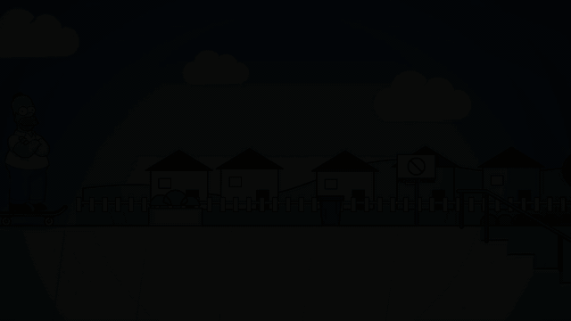

# Homero hace un ollie

Animación en canvas de Homero haciendo un ollie en skate sobre unas escaleras con pasamanos.

- `index.html`: la animación en vivo (botones de pausa, cámara lenta y reiniciar). Ábrela con un servidor local, p. ej. `python3 -m http.server` desde esta carpeta.
- `homer.png`: la imagen original con el fondo negro eliminado.
- `record.js`: exporta los cuadros con Playwright (`node record.js`); luego `ffmpeg` arma `homer-ollie.mp4` y `homer-ollie.gif`.
